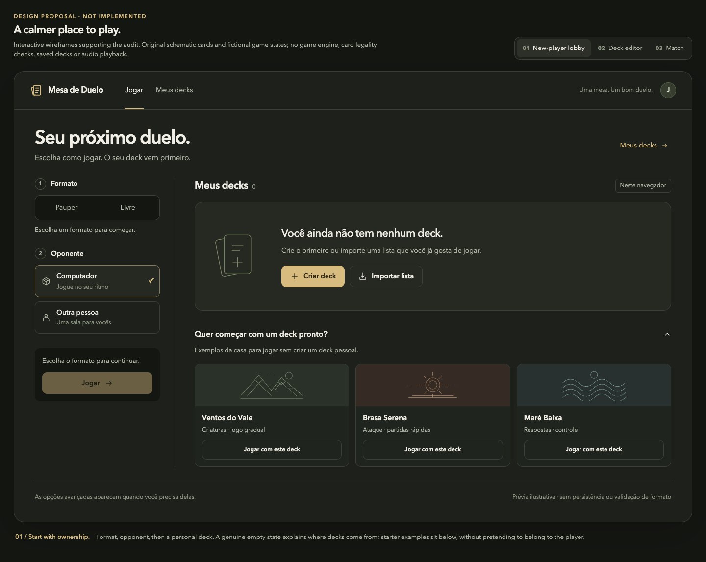
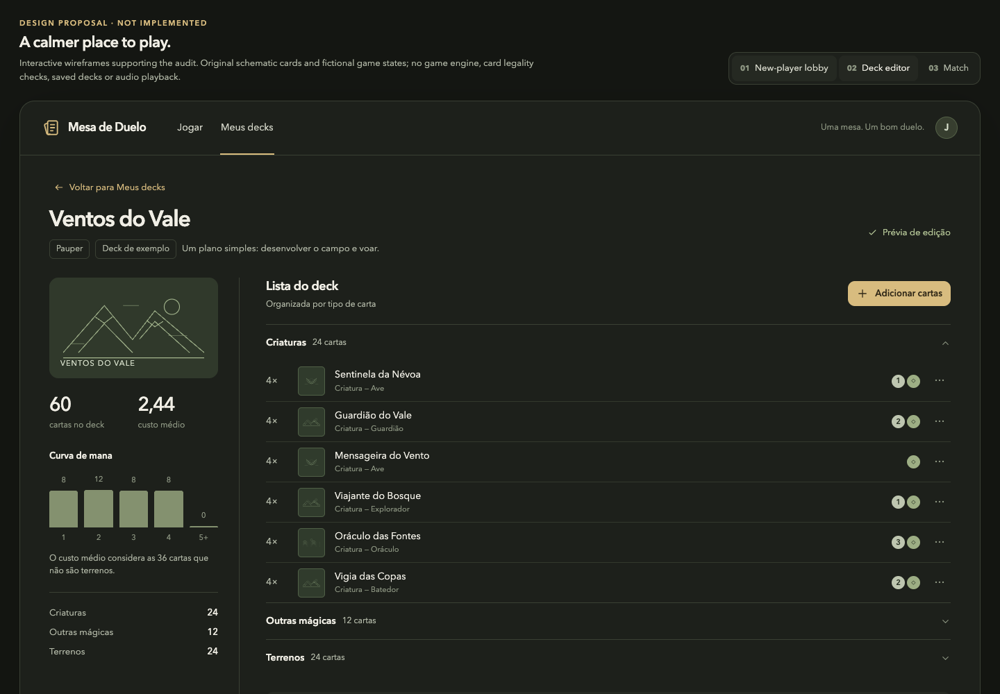
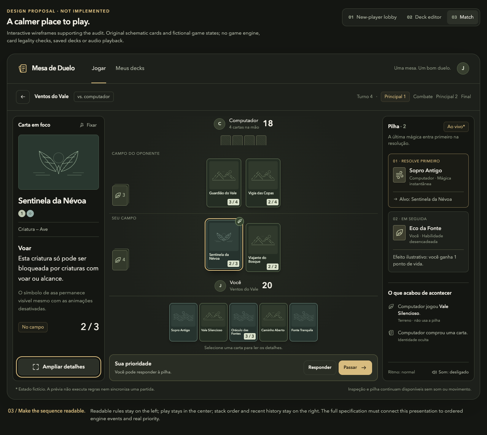

# Mesa de Duelo UI audit and Pauper specification

A repository-backed UI review, implementation plan, and supporting concepts. The actual app was run against Forge, including an AI game through turn five. **This change adds documentation and review assets; it does not implement the redesign or Pauper support.**

The proposed direction puts personal decks first, makes management visible, simplifies editing, adds readable card inspection, preserves opponent actions and stack history, and requires format/opponent selection before creating a match.

| Read | Contents |
| --- | --- |
| [UI specification](ui-ux-spec.md) | Prioritized Before/After findings, source locations, interaction contracts, delivery slices, acceptance criteria. |
| [Pauper plan](pauper-plan.md) | Official rules, Forge integration, authoritative legality, imports, sideboards, best-of-three, room configuration. |
| [24 screenshots](screenshots.md) | Current-app evidence with captions and capture limitations. |
| [Verification](verification.md) | Versions, reproducible runtime, build result, tested flows and unverified scenarios. |
| [Timing trace](gameplay-timing.json) | Sanitized real-game receive times; one observed AI turn spanned 475 ms. |
| [Interactive concepts](ui-concepts.html) | Proposed lobby, focused editor, and table; fictional cards/states, no game engine. |
| [Sound sketches](audio/index.html) | Seven original synthesized WAVs, manual playback and downloads; not integrated. |

The current baseline already uses sans-serif fonts and includes a stack panel and a flying marker. Their usability, visibility, and timing need improvement. The preview's card art, grouped lists, mana curve, and average mana cost should be preserved.

## Open the interactive review

GitHub displays HTML source rather than running these pages. After checking out this branch, run from the repository root:

```bash
python3 -m http.server 8877 --bind 127.0.0.1 --directory docs/ui-ux-audit
```

Open [the local review](http://127.0.0.1:8877). No npm dependencies or external assets are required for the review pages. Alternatively, open `index.html`, `ui-concepts.html`, or `audio/index.html` directly from this directory. The audio page never autoplays. Original synthesis source is [audio/generate.py](audio/generate.py); it regenerates the sketches in its own directory.

## Proposed layouts

These are schematic proposals, separate from the current-app evidence. The report frames can scroll; they do not certify the final game's viewport behavior. Format selection and template selection do not create personal decks.

### Lobby



### Focused editor



### Match



## Validation

Baseline `npm run build` passed with one existing CSS declaration warning. Browser audit covered 1512 × 850, 1440 × 900, 1280 × 720, and the 390 × 844 lobby. The local proposals were inspected in the browser; their tabs, search disclosure, detail dialog, format selection, and template selection were exercised. Source links and local asset references were checked. Audio passed format, duration and clipping checks; aesthetic listening remains unverified.

Full match completion, multiplayer, end-to-end Pauper, sideboarding, crowded battlefields, Safari/Retina, 200% zoom and screen-reader use remain unverified. See the verification record and specification acceptance criteria before implementing or approving those features.
