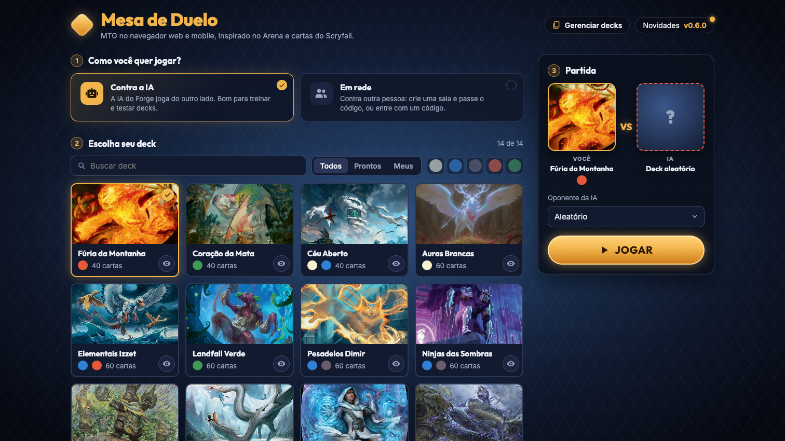
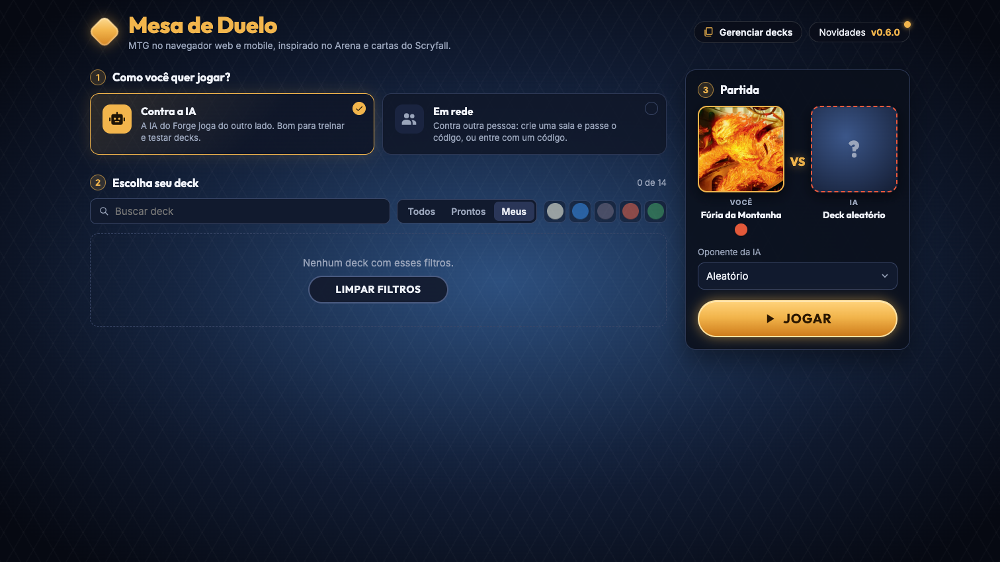
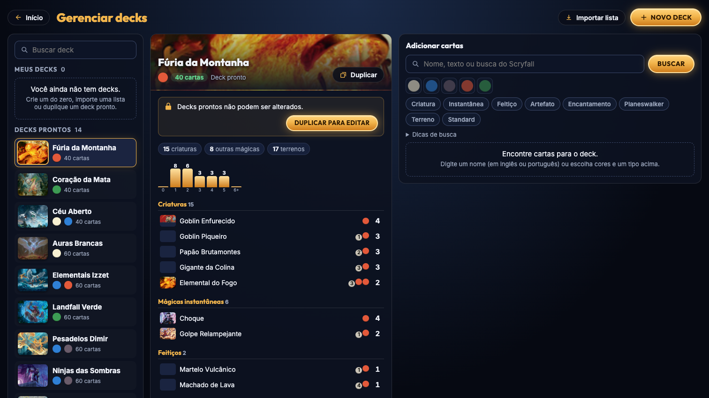
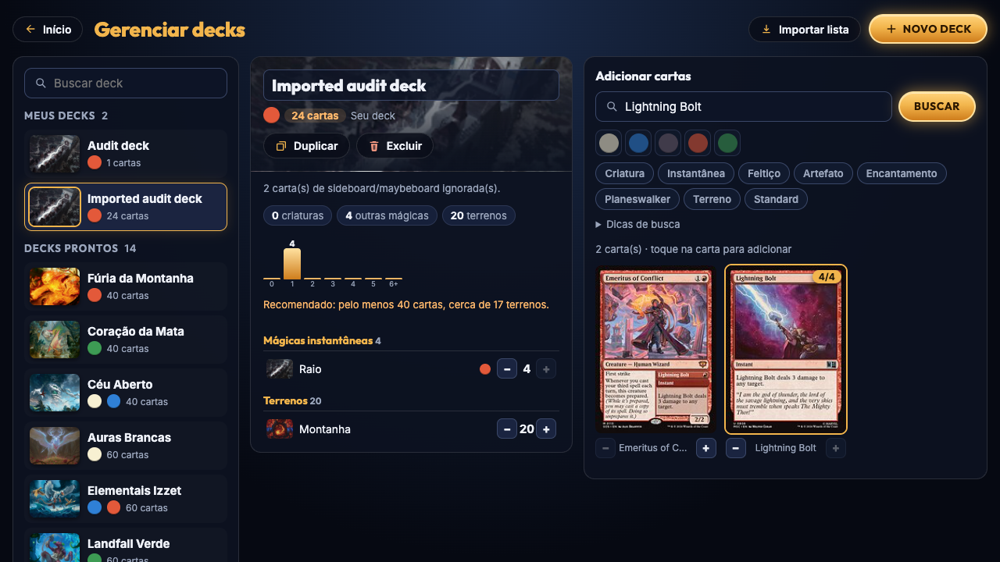
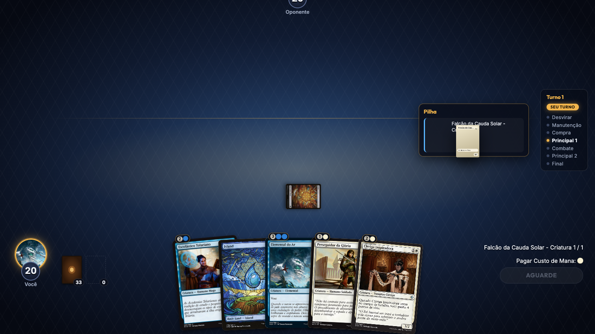
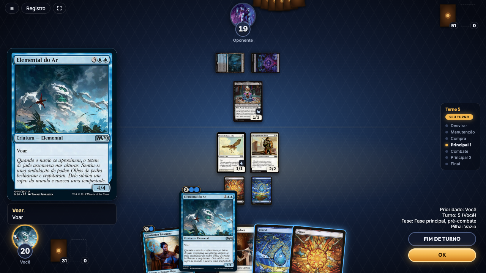
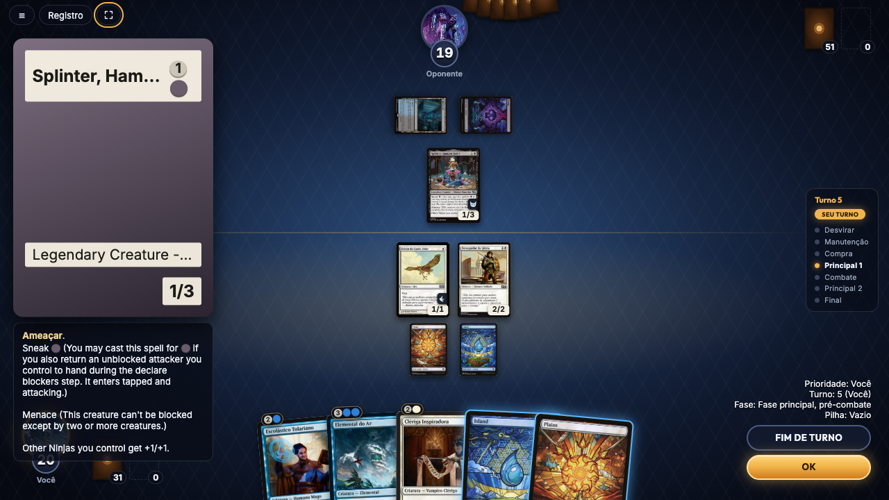
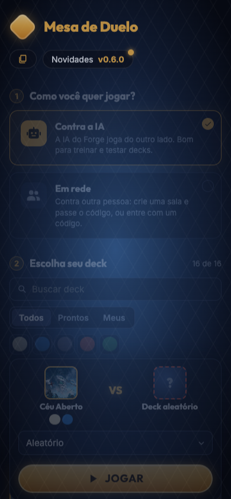

# Screenshot evidence

24 captures from the actual app at baseline `ef1cb1a`, October 16, 2026. Dimensions are CSS viewports. The proposed layouts are in [ui-concepts.html](ui-concepts.html), separate from these existing-app screenshots.

Captures 18–20 include an internal scrolling effect triggered by automation interacting with the partially clipped hand. Screenshot 26 uses pointer movement without automatic scrolling. Do not interpret the cropped top controls in those earlier captures as a universal responsive failure.

| Capture | Area | Evidence |
| --- | --- | --- |
| [01 — First load](screenshots/01-home-1512.png) | Lobby | Artwork still loading; no explicit loading treatment on the deck tiles. |
| [02 — Ready-made decks dominate](screenshots/02-home-loaded-1512.png) | Lobby | Fresh library begins with fourteen templates and an automatically selected deck. |
| [03 — Personal library empty state](screenshots/03-my-decks-empty-1512.png) | Lobby | The personal filter offers clearing filters instead of creating a deck. |
| [04 — Management opens everything](screenshots/04-deck-manager-1512.png) | Editor | Library, template details and card search appear together. |
| [05 — Laptop editor density](screenshots/05-deck-manager-1280.png) | Editor | The same three work areas at 1280 × 720. |
| [06 — New personal deck](screenshots/06-new-deck-1280.png) | Editor | A new empty deck opens inside the full editor layout. |
| [07 — Card search](screenshots/07-card-search-1280.png) | Editor | Searching for Lightning Bolt; inspected card search and result controls. |
| [08 — Adding a card](screenshots/08-card-added-1280.png) | Editor | One card added to a local audit deck; quantity controls and stats appear. |
| [09 — Editor inspection](screenshots/09-builder-inspector-1280.png) | Editor | Pointer inspection of a card in the editor at laptop width. |
| [10 — Import competes with search](screenshots/10-import-1280.png) | Editor | Import replaces the middle panel while the card-search area remains. |
| [11 — Sideboard discarded](screenshots/11-import-result-1280.png) | Editor | Imported 24 main cards plus 2 sideboard cards; only the 24 main cards persisted. |
| [12 — Personal decks below the fold](screenshots/12-personal-decks-below-templates-1280.png) | Lobby | Two audit decks exist, but fourteen templates precede them in the all-decks list. |
| [13 — Keep the useful deck preview](screenshots/13-deck-preview-1512.png) | Lobby | Grouped cards, mana curve, average cost and card art are valuable existing features. |
| [15 — Real match setup](screenshots/15-match-start-1512.png) | Gameplay | Play/draw prompt from the real Forge engine. |
| [16 — Opening hand](screenshots/16-mulligan-1512.png) | Gameplay | Keep/mulligan decision; a full match was not completed. |
| [18 — Mana payment](screenshots/18-cast-payment-1512.png) | Gameplay | Casting a creature exposes manual/automatic payment controls. Automation moved the internal arena scroll position during hand interaction. |
| [19 — The stack exists](screenshots/19-spell-stack-1512.png) | Gameplay | A live single-spell stack during card travel. It clears rapidly; this transient capture also has the internal-scroll artifact. |
| [20 — Existing flying marker](screenshots/20-flying-battlefield-1512.png) | Gameplay | A flyer is on the field with a wing badge. See screenshot 26 for the clean stationary viewport. |
| [26 — Laptop card inspector](screenshots/26-inspector-pointer-1280.png) | Gameplay | Clean pointer capture: 288 px-wide preview, 13 px rules, duplicated flying text. Central state is a real game. |
| [27 — History and localization](screenshots/27-game-log-1280.png) | Gameplay | Game log is available, but it does not replace an ordered visual account of actions. |
| [29 — Longer rules and fallback](screenshots/29-opponent-inspector-1280.png) | Gameplay | Opponent card fallback truncates the name and pushes rules over the life area. |
| [30 — Larger viewport comparison](screenshots/30-battlefield-1440.png) | Gameplay | Same live match at 1440 × 900, after combat and an AI creature play. |
| [31 — Narrow-screen discoverability](screenshots/31-lobby-mobile-390.png) | Lobby | At 390 × 844 the management label disappears; its button has no accessible name. |
| [32 — Network form](screenshots/32-network-setup-1440.png) | Network | Host/join form inspected. A two-player network game was not tested. |

## Key captures

### Ready-made decks dominate

Fresh library begins with fourteen templates and an automatically selected deck.

### Personal library empty state

The personal filter offers clearing filters instead of creating a deck.

### Management opens everything

Library, template details and card search appear together.

### Sideboard discarded

Imported 24 main cards plus 2 sideboard cards; only the 24 main cards persisted.

### The stack exists

A live single-spell stack during card travel. It clears rapidly; this transient capture also has the internal-scroll artifact.

### Laptop card inspector

Clean pointer capture: 288 px-wide preview, 13 px rules, duplicated flying text. Central state is a real game.

### Longer rules and fallback

Opponent card fallback truncates the name and pushes rules over the life area.

### Narrow-screen discoverability

At 390 × 844 the management label disappears; its button has no accessible name.
